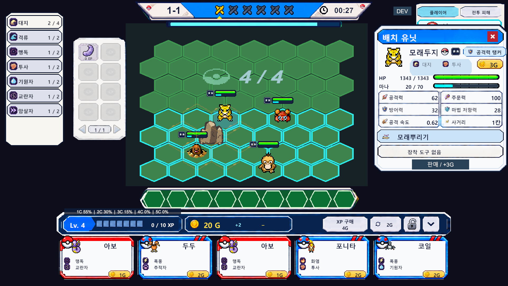
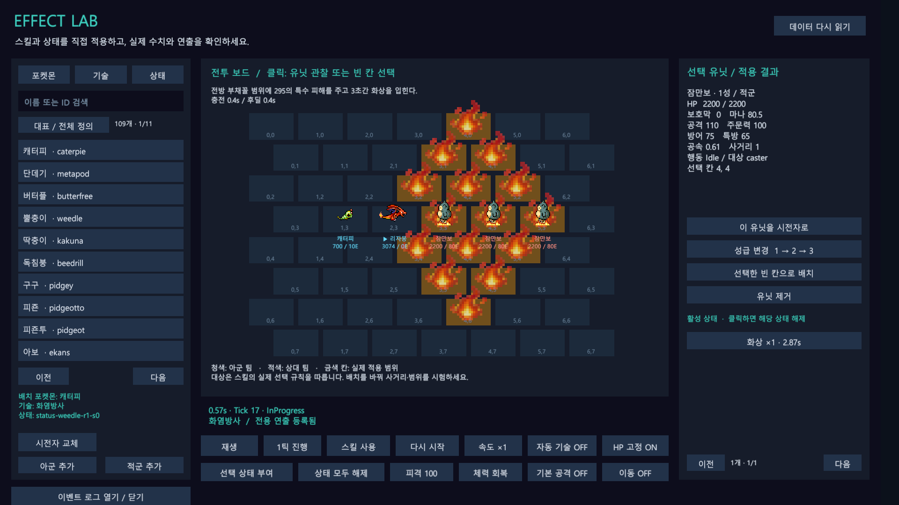
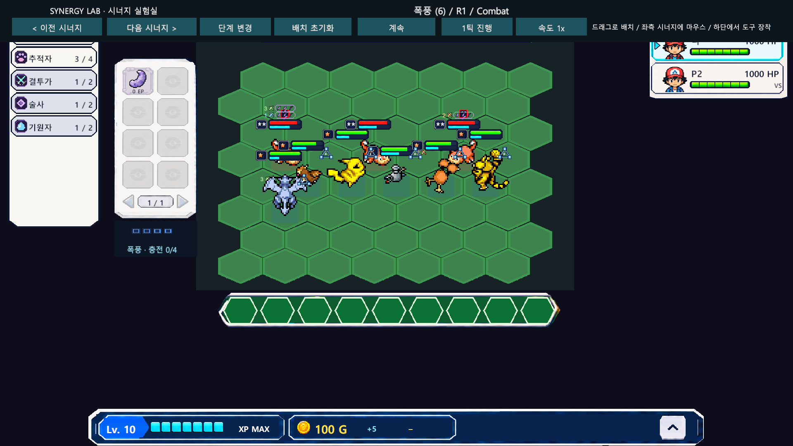
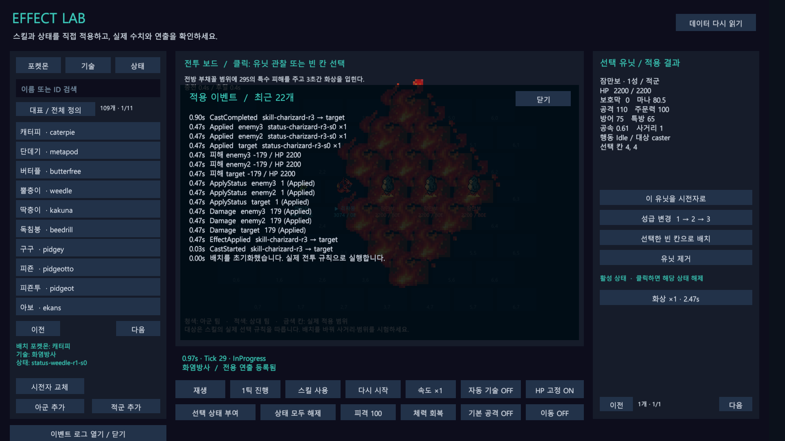
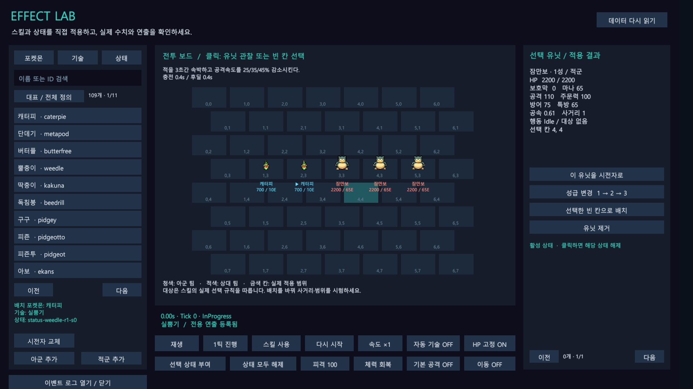
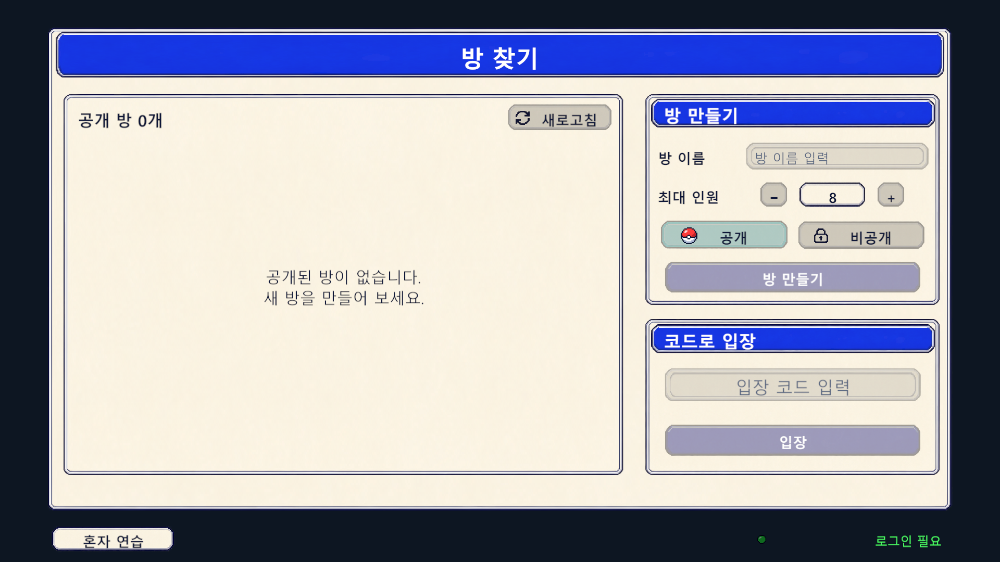

# PokeChess

**AI와 협업해 기획 분석부터 구현·검증까지 진행한 Unity 오토배틀러 프로젝트**

포켓몬을 구매하고 배치한 뒤, 성급 합성·진화·시너지·아이템 조합으로 팀을 성장시키는 전략 게임입니다. 헥스 보드에서 자동 전투가 진행되며, Host가 경기와 전투를 판정하는 2~8인 방 기반 멀티플레이 구조를 구현했습니다.

현재는 플레이 테스트와 UI 개선 단계입니다. 아래 이미지는 2026년 11월 23일 프로젝트에서 촬영한 실제 실행 화면입니다.

*시너지, 유닛 능력치와 스킬, 진화 포인트 및 상점을 함께 확인하는 준비 화면. 기존 로스터 데모를 사용한 로컬 촬영입니다.*

## 프로젝트 개요

| 항목 | 내용 |
| --- | --- |
| 장르 | 유닛 수집·조합 기반 오토배틀러 |
| 엔진·언어 | Unity 6.3 LTS · 6000.3.10f1 / C# |
| UI·콘텐츠 | uGUI / 프리팹 / ScriptableObject |
| 네트워크 | UGS Authentication · Multiplayer Services Sessions / Relay / Netcode for GameObjects |
| 계정 API | ASP.NET Core · .NET 10 / SQLite |
| 개발 지원 | Codex / Unity CLI·MCP |
| 콘텐츠 규모 | 포켓몬 109종, 상점 기본형 57종, 기원 8종·전투 특성 9종 |

정확한 버전은 [ProjectVersion](ProjectSettings/ProjectVersion.txt)과 [manifest](Packages/manifest.json)에서 확인할 수 있습니다.

## AI를 활용한 개발 과정

기획 의도와 우선순위, 플레이 결과에 대한 판단은 직접 수행하고, AI를 구조 분석·구현·반복 작업·검증을 지원하는 협업 도구로 활용했습니다.

**기획표·요구사항 → 기존 구현과 비교 → 변경 범위 결정 → 코드·에셋 수정 → 자동 검사·실제 플레이 → 피드백 반영**의 흐름으로 작업했습니다.

| 단계 | AI 활용 | 직접 수행한 판단·피드백 |
| --- | --- | --- |
| 기획·구조 검토 | 스킬·능력치·시너지 기획표와 코드의 차이 분석, 리팩토링 우선순위 검토 | 규칙 확정, 구현 범위와 작업 순서 결정 |
| 시스템 구현 | 전투·경제·온라인·UI 코드 작성과 공통 구조 확장 | 플레이 경험과 예외 규칙 검토, 변경 방향 제시 |
| 콘텐츠 관리 | 대량 에셋의 수치·참조·등록 검사와 반복 정리 | 콘텐츠 기획과 밸런스 수치 확정 |
| UI·연출 | UI 초안 이미지 제작, 스프라이트 분할·9-slice 설정·프리팹 연결 지원 | 실제 화면에서 배치·크기·타이밍·조작 방식 피드백 |
| 검증·문서화 | 재현 조건과 로그 분석, 회귀 검사, Unity 실행 확인과 문서 정리 | 결과 확인, 누락·오동작 제보와 수정 요청 |

## 주요 구현 내용

| 영역 | 구현 내용 |
| --- | --- |
| 경기·경제 | 준비·전투·다음 라운드 흐름, 골드·이자·경험치·레벨, 구매·판매·리롤·잠금, 공유 유닛 풀과 성급 합성 |
| 자동 전투 | 헥스 보드 이동·경로 탐색·타겟 선정, 기본 공격·투사체, 피해·회복·보호막·마나·상태이상 |
| 스킬·콘텐츠 | 109종 데이터와 성급별 능력치, 시간차·반복·범위 효과, 돌진·점프·넉백 및 독립 효과 |
| 진화·시너지 | 진화 포인트, 진화와 개인 상점 해금, 계열·전투 특성별 효과 및 관련 배치·선택 UI |
| 아이템·야생전 | 재료 2개 조합, 최대 3개 장착, 드래그 앤 드롭, 몬스터 처치 시 보관함으로 보상 지급 |
| 온라인 | 방 생성·검색·코드 입장·Ready·시작, Host 명령 검증, 상태 동기화·관전·재접속 |
| UI·표현 | 주요 UI 프리팹화, HUD·유닛 정보·툴팁·상점·조합 UI, 로비·대기실 및 스킬·상태·시너지 연출 |
| 개발 도구 | EffectLab, SynergyLab, 매판 다른 시드와 규칙 기반 상대 봇을 사용하는 Playtest 씬 |

### 기획 변경에 대응하는 콘텐츠 구조

새 스킬·능력치 기획을 기존 구현과 비교해 공통 실행 구조를 확장했습니다. 성급별 수치를 하나의 편집 에셋에서 관리하고, Inspector에서 설명과 검증 결과를 확인하도록 작성 흐름을 개선했습니다.

현재 편집 원본은 `Content/Pokemon`, `Content/Skills`, `Content/Statuses`의 `.asset`입니다. `GameRoster`는 등록 목록이며, 엑셀과 `SkillPlan.json`은 참고·가져오기 자료로 사용합니다. Unity 에셋을 불변 Core 정의로 변환해 실제 전투에서 사용합니다.

### 실제 판정에 연결한 스킬 연출

*EffectLab에서 리자몽 3성의 화염방사 범위와 화상 상태를 확인하는 장면입니다.*

이펙트를 실제 피해·상태 적용·이동 도착 이벤트에 연결했습니다. 범위 공격은 실제 적용된 칸에 표시하고, 보호막·속박 같은 유지 효과는 실제 상태의 수명에 맞춰 종료합니다. 타격 시점·방향·레이어를 공통 카탈로그와 재생기로 관리합니다.

### 재현 가능한 전투·스킬 검증 도구

*SynergyLab의 폭풍 6단계 로컬 전투. 시너지·단계별 프리셋과 틱 단위 진행을 사용하며, 체력 등은 실험용 설정입니다.*

EffectLab에서는 포켓몬·성급·배치·기술·상태를 바꿔 실제 전투 규칙을 시험할 수 있습니다. 일시정지, 1틱 진행, 속도 조절, 유닛 상태 관찰과 이벤트 로그를 제공해 특정 상황을 반복 확인하도록 구성했습니다.

*시전 시작 → 효과 적용 → 피해 → 상태 부여를 로그로 대조합니다. EffectLab 촬영은 HP 고정 모드로, 계산 피해와 이벤트는 유지하되 실제 HP 감소를 막습니다.*

EffectLab 전체 화면

포켓몬·기술·상태 목록, 전투 보드, 선택 유닛 정보와 실행 제어를 한 화면에 배치했습니다. 목록은 등록된 콘텐츠에서 읽으며 테스트 중 원본 에셋 수치를 변경하지 않습니다.

### 온라인 명령 처리와 상태 복원

Host가 클라이언트 명령을 검증하고 공통 Core 경로로 상태를 변경합니다. 요청 ID·sequence를 기록해 중복 요청으로 인한 자원 중복 차감이나 보상 중복 지급을 방지합니다.

공개 정보, 본인 전용 정보와 Host 전용 정보를 구분합니다. 상대 상점·벤치 등 비공개 정보는 전송 단계에서 제외하고, 재접속 시 현재 Snapshot과 전투 baseline으로 상태를 복원합니다. non-Host 단절에는 120초 유예를 적용합니다.

*방 목록·방 생성·인원 조절·공개 여부·코드 입장을 통합한 로비입니다. 촬영 당시에는 로그인 필요·공개 방 0개 상태이며, 다인 접속 성공을 증명하는 이미지는 아닙니다.*

### 실제 입력 검증으로 발견한 초기화 의존성

자체 로그인 화면을 비활성화한 뒤 Boot의 버튼이 클릭되지 않는 문제를 분석했습니다. EventSystem 생성이 로그인 UI에 묶여 있던 원인을 찾아 Boot 공통 초기화로 분리했습니다.

버튼 함수를 직접 호출하는 검사에서 놓친 문제를 실제 마우스 입력으로 확인했고, 수정 후 인원 변경과 로컬 경기 진입을 검증했습니다. 자동 검사와 사용자 조작 검증을 함께 수행하는 계기가 된 사례입니다.

## 시스템 구성

| 계층 | 책임 |
| --- | --- |
| [Core](Assets/_Project/Scripts/Core) | Unity·네트워크에 의존하지 않는 순수 C# 규칙, 상태, 전투·경기 시뮬레이션 |
| [Content](Assets/_Project/Scripts/Content) | ScriptableObject 작성·검증과 Core 정의 변환 |
| [Network](Assets/_Project/Scripts/Network) | 인증·세션·연결, 명령과 Snapshot 전송 |
| [Client](Assets/_Project/Scripts/Client) | 입력, uGUI, 화면 상태, 애니메이션·오디오·관전 |
| [Editor](Assets/_Project/Scripts/Editor) | 콘텐츠·씬 생성 및 에셋 검증 도구 |
| [Tests](Assets/_Project/Tests/EditMode/Core) | 규칙·콘텐츠·온라인·표현·계층 경계 회귀 검사 |

Core 시간은 Tick으로 관리하고, 난수는 seed와 목적별 스트림으로 주입합니다. 로컬과 온라인에서 같은 규칙 경로를 사용하고, 화면의 애니메이션 완료 여부가 전투 결과를 결정하지 않도록 분리했습니다.

## 검증 기록과 현재 범위

| 항목 | 기록·범위 |
| --- | --- |
| 자동 회귀 | 스킬·능력치 전환 당시 EditMode 1,436개 통과, Core 독립 실행 1,050개 통과 이력 |
| 결정성 검사 | CombatSandbox에서 10개 시나리오 × 10개 seed × 기본·replay·순서 반전의 300회 전투 비교 구성 |
| 온라인 실행 | 같은 PC에서 Editor ↔ Windows Player의 2프로세스 접속·재접속 검증 이력 |
| 남은 실환경 검증 | 다른 PC·외부망의 실제 4~8인 플레이, 장기 안정성과 전체 조합 밸런스 |
| 계정 API | 로그인·가입·복구·세션 복원 및 배포 패키지 준비. 운영 서버 배포·UGS 운영 연결 검증은 미완료 |

테스트 수치는 각각의 변경 당시 기록이며 합산하지 않습니다. 최신 버전 전체를 다시 검증했다는 의미는 아닙니다. 로컬 테스트와 다인 실서비스 검증을 구분합니다.

자체 로그인은 현재 기본 Boot 테스트 흐름에서 일시 제외했습니다. 로컬 플레이와 UGS 익명 온라인 방 테스트 경로를 유지합니다. Dedicated Server와 Host Migration은 현재 구현 범위에 포함하지 않습니다.

## 실행 방법

1. Unity Hub에서 이 저장소 폴더를 Unity **6000.3.10f1**로 엽니다.
2. 패키지 가져오기와 스크립트 컴파일이 끝날 때까지 기다립니다.
3. 목적에 맞는 씬을 열고 Play를 실행합니다.

| 씬 | 용도 |
| --- | --- |
| [Boot](Assets/_Project/Scenes/Boot.unity) | 방 UI와 로컬 경기 진입 |
| [Playtest](Assets/_Project/Scenes/Playtest.unity) | 새 시드·규칙 기반 봇과 반복 플레이 |
| [EffectLab](Assets/_Project/Scenes/EffectLab.unity) | 개별 스킬·상태·연출 검토 |
| [SynergyLab](Assets/_Project/Scenes/SynergyLab.unity) | 시너지 프리셋 배치와 전투 검토 |

온라인 테스트에는 Unity 프로젝트 연결과 Authentication·Multiplayer·Relay 설정이 필요합니다. 로컬 플레이는 UGS 응답을 기다리지 않고 사용할 수 있습니다. 자체 계정 서버의 설치·배포 자료는 [Account API 안내](Server/AccountApi/deploy/README.md)를 참고하세요.

EditMode 회귀 검사는 Unity의 Test Runner에서 실행할 수 있습니다. Unity CLI를 사용하는 경우 실행 중인 Editor의 프로젝트를 확인한 뒤 해당 Editor의 테스트 명령을 사용합니다.

---

게임 규칙·개발 상세 문서는 개발 작업공간의 상위 `Docs/` 폴더에서 관리합니다. 해당 폴더는 이 Git 저장소 바깥에 있으므로 이 README는 저장소 안의 소스·씬·이미지를 직접 연결합니다.
